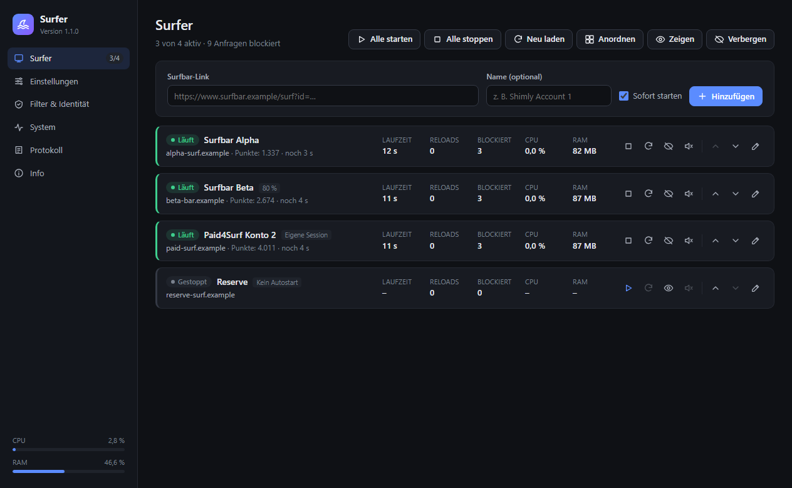
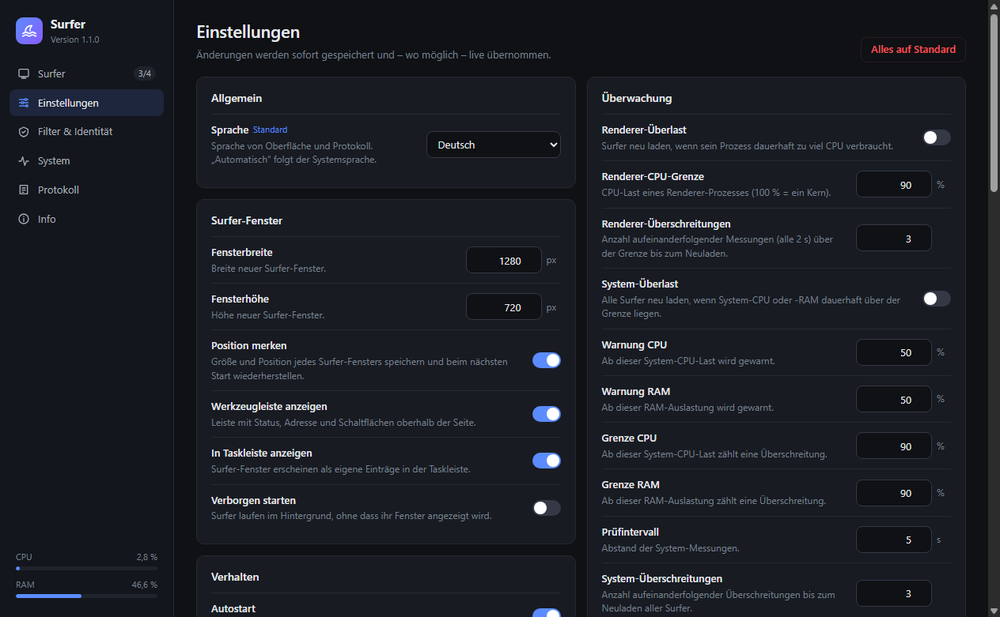

# Surfer

[English](README.md) · **Deutsch**

Surfer ist ein auf Electron basierender Browser für Surfbars. Du steuerst alles in einem **Hauptfenster**, und **jeder Surfer läuft in einem eigenen Subfenster**. Textdateien oder Konsolenbefehle brauchst du dafür nicht.

Läuft unter **Windows**, **Linux** und **macOS**. Die Oberfläche gibt es auf **Deutsch und Englisch**. Sie richtet sich automatisch nach der Systemsprache und lässt sich unter *Einstellungen → Allgemein* umstellen.



---

## Installation

1. **Node.js installieren** (Version 20 oder neuer): 👉 [nodejs.org](https://nodejs.org/en/download)
2. **Projekt herunterladen**: 👉 [ZIP herunterladen](https://github.com/dev-101010/surfer/archive/refs/heads/master.zip) und in einen beliebigen Ordner entpacken.
3. **Starten**
   - **Windows:** Doppelklick auf `start.bat`
   - **Linux/macOS:** einmalig `chmod +x start.sh`, danach `./start.sh`

Beim ersten Start installiert das Startskript die Abhängigkeiten automatisch, nur dann ist ein Konsolenfenster zu sehen. Danach öffnet sich das Hauptfenster, und Surfer läuft ohne Konsole weiter. Ein zweiter Start holt einfach das vorhandene Hauptfenster nach vorn.

**Fehlersuche:** `start-debug.bat` (Windows) bzw. `./start.sh --debug` startet Surfer mit offener Konsole und Live-Protokoll. Scheitert der Start, zeigt Surfer eine Fehlermeldung und schreibt Details nach `logs/startup-error.log`. Unter Linux und macOS steht die Ausgabe zusätzlich in `logs/start.log`.

**Linux-Hinweis:** Auf manchen Systemen (z. B. Ubuntu 24.04) ist die Chromium-Sandbox blockiert. `start.sh` erkennt das und zeigt den passenden Befehl zur Behebung an.

---

## Bedienung

### Hauptfenster

| Bereich | Funktion |
|---|---|
| **Surfer** | Surfbar-Links hinzufügen, umbenennen, sortieren und löschen. Pro Surfer: starten/stoppen, neu laden, Fenster zeigen/verbergen, Ton, Zoom, Autostart, eigene Session. Sammelaktionen: alle starten/stoppen/neu laden, Fenster im Raster anordnen, alle zeigen/verbergen. Live-Anzeige von Status, Seitentitel, Laufzeit, Reloads, blockierten Anfragen sowie CPU und RAM. |
| **Einstellungen** | Alle Optionen als Schalter, Zahlenfeld oder Auswahl mit Erklärung. Werte werden geprüft, sofort gespeichert und wo möglich live übernommen. Jede Option lässt sich einzeln auf den Standard zurücksetzen. |
| **Filter & Identität** | Whitelist, gesperrte Domains, gesperrte Dateiendungen, Captcha-Whitelist und User-Agent. Ungültige Einträge werden gemeldet und verworfen. |
| **System** | System-CPU und -RAM mit 5-Minuten-Verlauf, alle Prozesse mit Zuordnung zum Surfer, Werkzeuge (Session leeren, Ordner öffnen). |
| **Protokoll** | Live-Protokoll mit Filter nach Stufe und Text sowie Export. |
| **Info** | Konzept, Versionen, Pfade und **Updates**. |



### Surfer-Subfenster

Jedes Surfer-Fenster hat oben eine Werkzeugleiste mit Status, Adresse, *Zurück*, *Neu laden*, *Start-Adresse*, Zoom, Ton, *Verbergen* und *Hauptfenster*. Ein verborgener Surfer läuft im Hintergrund weiter. Schließt du ein Surfer-Fenster, wird nur dieser Surfer gestoppt. Schließt du das Hauptfenster, wird Surfer beendet (mit Rückfrage, falls noch Surfer laufen).

---

## Funktionen

**Wächter**
- Nach Absturz, Ladefehler oder Hänger wird die Seite automatisch neu geladen. Die Wartezeit verdoppelt sich bei jedem weiteren Fehler (bis 32×).
- Optional:
  - Reload-Intervall
  - Stillstand-Erkennung: Neuladen, wenn sich Adresse, Titel und Frames nicht mehr ändern, auch wenn eine Seite im Laden hängt
  - Überlastschutz für einzelne Renderer und für das ganze System
- `alert`/`confirm`/`prompt` und `beforeunload` können einen unbeaufsichtigten Surfer nicht mehr blockieren.

**Seiten-Skripte** (laufen vor den Seitenskripten in jedem Frame)
- Sichtbarkeit und Fokus werden vorgetäuscht, auch in iFrames.
- Optional werden Mausbewegungen simuliert.
- Der DOM-Wächter entfernt Video-/Audio-Elemente und `srcdoc`-iFrames, sobald sie auftauchen.

**Filter**
Geprüft wird der echte Hostname inklusive Subdomains, nicht mehr ein beliebiger Textausschnitt der URL. Die Reihenfolge:
Captcha-Whitelist → iFrame-Tiefe → Whitelist → Medien → gesperrte Domains → Dateiendungen (Pfad ohne Query) → WebSockets / blob- und data-Frames.
Dazu kommen Download-Sperre, Navigationssperre auf die eigene Domain, Popup-Filter mit Limit pro Surfer und der Schutz gegen WebRTC-IP-Leaks.

**Sitzungen**
Standardmäßig teilen sich alle Surfer eine dauerhafte Browser-Sitzung, ein Login gilt also für alle. Ein Surfer mit „Eigene Session“ hat eigene Cookies. Der Zoom gilt pro Fenster, auch bei Surfern auf derselben Seite.

**Härtung**
- Seiteninhalte laufen in einer Sandbox mit Context Isolation, ohne Node.js, ohne DevTools, ohne `<webview>`.
- Alle Berechtigungsanfragen (Kamera, Mikrofon, Standort, Benachrichtigungen …) werden abgelehnt.
- Die eigene Oberfläche hat eine strikte CSP. IPC-Aufrufe werden nur vom Hauptfenster angenommen und alle Eingaben im Hauptprozess geprüft.
- Aus fremden Texten (Seitentitel, URLs) werden Steuerzeichen entfernt, bevor sie in Konsole oder Logdatei landen.
- Die Konfiguration wird atomar geschrieben und gesichert (`settings.json.bak`). Eine beschädigte Datei wird erkannt und beiseitegelegt.
- Der Standard-User-Agent enthält keine Electron-Kennung.

---

## Updates

Surfer sucht beim Start und danach alle 24 Stunden auf GitHub nach einer neuen Version (abschaltbar unter *Einstellungen → Updates*). Ist eine neue Version verfügbar, erscheint ein Hinweis, und unter **Info → Updates** kannst du sie installieren:

1. Die neue Version wird heruntergeladen und geprüft.
2. Die aktuelle Version wird nach `backup/<version>-<zeitpunkt>/` gesichert. Die 3 neuesten Sicherungen bleiben erhalten.
3. Die Programmdateien werden ersetzt. `config/`, `logs/` und `node_modules/` bleiben unverändert.
4. Schlägt etwas fehl, wird die alte Version automatisch wiederhergestellt.
5. Neustart. Haben sich die Abhängigkeiten geändert, beendest du Surfer und startest ihn über `start.bat`/`start.sh` neu. Das Skript installiert sie dann automatisch.

Bei einem Git-Checkout wird nur geprüft, nicht installiert. Aktualisiere dann mit `git pull`.

---

## Dateien

| Pfad | Inhalt |
|---|---|
| `config/settings.json` | Gesamte Konfiguration (Einstellungen, Listen, Surfer). Wird über das Hauptfenster verwaltet. |
| `logs/surfer.log` | Protokolldatei (nur wenn aktiviert, rotiert bei 5 MB) |
| `logs/startup-error.log`, `logs/start.log` | Fehler beim Programmstart |
| `backup/` | Sicherungen vor Updates |

**Umstieg von v0.x:** Beim ersten Start werden die alten Dateien in `config/` (`config.json`, `browser_deep_config.json`, `surfbar_links.txt`, `whitelist.txt` usw.) automatisch in `settings.json` übernommen. Danach werden sie nicht mehr verwendet.

Für mehrere getrennte Installationen oder zum Testen kann mit der Umgebungsvariable `SURFER_CONFIG_DIR` ein anderer Konfigurationsordner gewählt werden. Er bekommt dann auch ein eigenes Browserprofil.

---

## Entwicklung

```bash
npm install
npm start      # Surfer starten
npm test       # Unit-Tests (Filter, Domains, Konfiguration, Updater, Logger, Übersetzungen)
npm run icons  # assets/icon.png und icon.ico aus der Icon-Definition neu erzeugen
```

Aufbau:

```
src/main/          Hauptprozess
  main.js            Einstieg, Chromium-Schalter, Lebenszyklus
  control.js         Hauptfenster + IPC-Schnittstelle
  surfer-manager.js  Sessions, Request-Filter, Popups, Metriken, Überlast
  surfer.js          ein Surfer = BaseWindow mit Werkzeugleiste + Inhalt
  filter.js          Filterentscheidungen (ohne Electron, getestet)
  config-store.js    Laden/Validieren/Speichern, Migration
  schema.js          alle Einstellungen mit Typ und Grenzen
  i18n.js            deutsche und englische Texte
  updater.js         Update-Prüfung und -Installation
src/preload/       Brücken zwischen Seiten und Hauptprozess
src/renderer/      Hauptfenster (control) und Werkzeugleiste (toolbar)
test/              node:test-Suite
assets/            App-Icon (SVG, PNG, ICO)
docs/              Screenshots
scripts/           build-icons.js
```

Neue Texte gehören in `src/main/i18n.js`, und zwar in **beiden** Sprachen. `npm test` schlägt fehl, wenn ein Schlüssel in einer Sprache fehlt oder ein im Code verwendeter Schlüssel nicht existiert.

---

## Lizenz

Copyright © 2025–2026 Dennis Drochmann

Surfer ist freie Software: Du kannst sie unter den Bedingungen der **GNU General Public License**, wie von der Free Software Foundation veröffentlicht, weitergeben und/oder verändern, entweder gemäß Version 3 der Lizenz oder (nach deiner Wahl) jeder späteren Version. Surfer wird in der Hoffnung verbreitet, dass es nützlich ist, aber **ohne jede Gewährleistung**. Rechtlich verbindlich ist der englische Originaltext in [LICENSE](LICENSE).
