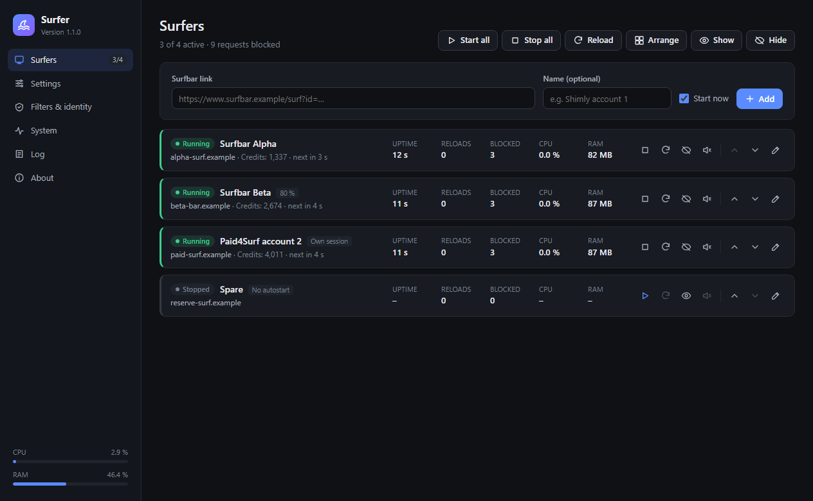
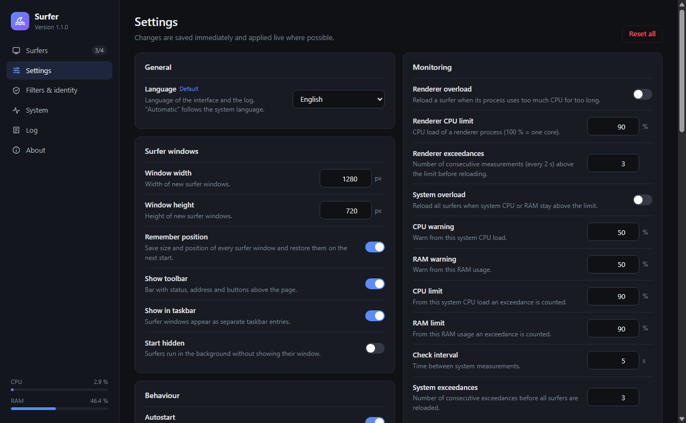

# Surfer

**English** · [Deutsch](README.de.md)

Surfer is an Electron-based browser for surfbars. You control everything from one **main window**, and **every surfer runs in its own sub window**. You don't need text files or console commands.

Runs on **Windows**, **Linux** and **macOS**. The interface is available in **English and German** and follows the system language automatically; you can switch it under *Settings → General*.



---

## Installation

1. **Install Node.js** (version 20 or newer): 👉 [nodejs.org](https://nodejs.org/en/download)
2. **Download the project**: 👉 [Download ZIP](https://github.com/dev-101010/surfer/archive/refs/heads/master.zip) and extract it to any folder.
3. **Start**
   - **Windows:** double-click `start.bat`
   - **Linux/macOS:** run `chmod +x start.sh` once, then `./start.sh`

On the first start the script installs the dependencies automatically; a console window is visible only while that happens. Then the main window opens and Surfer keeps running without a console. Starting it again just brings the existing main window to the front.

**Troubleshooting:** `start-debug.bat` (Windows) or `./start.sh --debug` starts Surfer with an open console and live log. If the start fails, Surfer shows an error message and writes details to `logs/startup-error.log`. On Linux/macOS the output is also written to `logs/start.log`.

**Linux note:** on some systems (e.g. Ubuntu 24.04) the Chromium sandbox is blocked. `start.sh` detects this and shows the command to fix it.

---

## Usage

### Main window

| Section | What it does |
|---|---|
| **Surfers** | Add, rename, sort and remove surfbar links. Per surfer: start/stop, reload, show/hide window, audio, zoom, autostart, own session. Bulk actions: start/stop/reload all, arrange windows in a grid, show/hide all. Live status, page title, uptime, reloads, blocked requests, CPU and RAM. |
| **Settings** | Every option as a switch, number field or selection with an explanation. Values are validated, saved immediately and applied live where possible. Each option can be reset to its default. |
| **Filters & identity** | Whitelist, blocked domains, blocked file extensions, captcha whitelist and user agent. Invalid entries are reported and discarded. |
| **System** | System CPU and RAM with a 5-minute history, all processes with their surfer, tools (clear session, open folders). |
| **Log** | Live log with level and text filter, export. |
| **About** | Concept, versions, paths and **updates**. |



### Surfer sub windows

Every surfer window has a toolbar at the top with status, address, *back*, *reload*, *start address*, zoom, audio, *hide* and *main window*. A hidden surfer keeps running in the background. Closing a surfer window only stops that surfer. Closing the main window quits Surfer (with a confirmation if surfers are still running).

---

## Features

**Watchdogs**
- After a crash, load error or hang, the page is reloaded automatically. The delay doubles with every further error (up to 32×).
- Optional:
  - reload interval
  - stall detection: reload when address, title and frames stop changing, also when a page hangs while loading
  - overload protection for single renderers and the whole system
- `alert`/`confirm`/`prompt` and `beforeunload` can no longer block an unattended surfer.

**Page scripts** (run before the page's own scripts, in every frame)
- Visibility and focus are faked, also in iframes.
- Mouse movements can optionally be simulated.
- The DOM guard removes video/audio elements and `srcdoc` iframes as soon as they appear.

**Filters**
Requests are checked against the real host name including subdomains, not against arbitrary parts of the URL text. The order is:
captcha whitelist → iframe depth → whitelist → media → blocked domains → file extensions (path without query) → WebSockets / blob and data frames.
Additionally: download blocking, navigation restricted to the surfer's own domain, popup filter with a per-surfer limit, and protection against WebRTC IP leaks.

**Sessions**
By default all surfers share one persistent browser session, so one login works for all of them. A surfer with "Own session" has its own cookies. Zoom is kept per window, even for surfers on the same site.

**Hardening**
- Page content runs sandboxed with context isolation, without Node.js, DevTools or `<webview>`.
- All permission requests (camera, microphone, location, notifications …) are denied.
- The app's own UI uses a strict CSP. IPC calls are only accepted from the main window and all input is validated in the main process.
- Untrusted text (page titles, URLs) is stripped of control characters before it reaches the console or log file.
- The configuration is written atomically with a backup (`settings.json.bak`); a corrupt file is detected and set aside.
- The default user agent contains no Electron marker.

---

## Updates

Surfer checks GitHub for a new version at startup and every 24 hours (can be switched off under *Settings → Updates*). If a new version is available, a notice appears, and you can install it under **About → Updates**:

1. The new version is downloaded and verified.
2. The current version is backed up to `backup/<version>-<time>/`; the 3 newest backups are kept.
3. The program files are replaced. `config/`, `logs/` and `node_modules/` stay untouched.
4. If anything fails, the previous version is restored automatically.
5. Restart. If the dependencies changed, quit Surfer and start it via `start.bat`/`start.sh`, which then installs them automatically.

Git checkouts are only checked, never overwritten. Update them with `git pull`.

---

## Files

| Path | Contents |
|---|---|
| `config/settings.json` | Complete configuration (settings, lists, surfers), managed through the main window |
| `logs/surfer.log` | Log file (only if enabled, rotates at 5 MB) |
| `logs/startup-error.log`, `logs/start.log` | Errors during startup |
| `backup/` | Backups made before updates |

**Upgrading from v0.x:** on the first start the old files in `config/` (`config.json`, `browser_deep_config.json`, `surfbar_links.txt`, `whitelist.txt` …) are imported into `settings.json` automatically. They are no longer used afterwards.

To run several separate installations, or for testing, set the environment variable `SURFER_CONFIG_DIR` to another configuration folder; it then also gets its own browser profile.

---

## Development

```bash
npm install
npm start      # start Surfer
npm test       # unit tests (filters, domains, configuration, updater, logger, translations)
npm run icons  # regenerate assets/icon.png and icon.ico from the icon definition
```

Structure:

```
src/main/          main process
  main.js            entry point, Chromium switches, lifecycle
  control.js         main window + IPC interface
  surfer-manager.js  sessions, request filter, popups, metrics, overload
  surfer.js          one surfer = BaseWindow with toolbar + content
  filter.js          filter decisions (no Electron, unit tested)
  config-store.js    load/validate/save, migration
  schema.js          all settings with type and limits
  i18n.js            German and English texts
  updater.js         update check and installation
src/preload/       bridges between pages and main process
src/renderer/      main window (control) and toolbar
test/              node:test suite
assets/            app icon (SVG, PNG, ICO)
docs/              screenshots
scripts/           build-icons.js
```

New texts go into `src/main/i18n.js` in **both** languages. `npm test` fails if a key is missing in one language or a key used in the code does not exist.
